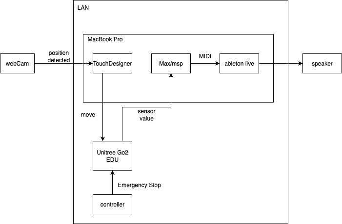

# ZOUNOHANA2026 for Mac

Unitree Go2 EDU を使ったサウンドインスタレーションの、Mac 側一式。

- 天井カメラと TouchDesigner でロボットの位置を推定し、決まったルートを歩かせる。
- 歩いているときの足裏の力と IMU を OSC で Max/MSP に送る。
- Max で音符・音量・定位に変換し、Ableton Live を鳴らす。

## システム構成



```
[webCam] → [TouchDesigner]  ArUco で位置を推定、ルート、E-stop
              │  OSC（/dog/pose, /go2pf/*）  ssh で起動
              ▼
         [Go2 EDU 拡張PC (Jetson)] go2pf → SportClient.Move → [Go2 本体]
              │
              │  足裏の力・IMU（/gait/force, /imu/rpy）
              ▼
[Max/MSP  innu.maxpat] → OSC → [Ableton Live  test1.als] → スピーカー
```

ロボットはリモコン（controller）でも操作できる。非常停止は TD のスペースキーと、リモコンの両方で行う。

## フォルダ構成

| パス | 内容 |
|---|---|
| `Go2PathFollower/` | ルート追従コントローラー go2pf（Python）と、TD 側の制御一式。詳細は [Go2PathFollower/README.md](Go2PathFollower/README.md) |
| `innu.maxpat` | メインの Max パッチ。センサー値を音に変換する |
| `cyclePoly.maxpat` | 小さな Max の試作パッチ（`cycle~` のオン/オフ） |
| `osc_replay_ctrl.py` | 記録した `*_raw.csv` を、記録時と同じタイミングで OSC 再生する（ロボットなしで作業するため） |
| `20261031_190643_raw.csv` | 2026-10-31 の実機の記録（`/gait/force` と `/imu/rpy`、約 10,900 件ずつ） |
| `pos.toe`, `pos.14.toe` | TouchDesigner のプロジェクト（`pos.14.toe` は自動保存された版） |
| `Backup/` | `pos.toe` の自動バックアップ（`pos.1`〜`pos.13`） |
| `test1 Project/` | Ableton Live のプロジェクト（`test1.als` と録音・サンプル） |
| `techRider.drawio` / `.png` | テクニカルライダー（機材とつながりの図） |
| `isaac_sim/`, `isaac_sim.zip` | 研究室の Windows PC（RTX 4090）に Isaac Sim 6.2 の環境を作るキット。詳細は [isaac_sim/README.md](isaac_sim/README.md) |
| `drafts/go2_osc_sim.py` | Isaac Sim 上の Go2 をラジコン操作し、実機と同じ形式の `/gait/force` を送るシミュレーター（試作、未実行） |

## OSC

### センサー → Max（`innu.maxpat` の `udpreceive`）

入力元によって、受けるポートが違う。`udpreceive` の番号を入力元に合わせて切り替える。

| ポート | 入力元 |
|---|---|
| 9898 | Isaac Sim（Windows PC） |
| 9871 | `osc_replay_ctrl.py`（記録 CSV の再生） |

| アドレス | 引数 | 内容 |
|---|---|---|
| `/gait/force` | `i i i i` | 足裏の力。FR FL RR RL の順。FL は他の足の約半分の値が出る |
| `/imu/rpy` | `f f f` | roll, pitch, yaw [rad] |
| `/hit` | | Isaac Sim からのトリガー。`/hitT` を 8484 へ送る |

### Max → 外部

| 送り先 | アドレス | 内容 |
|---|---|---|
| `127.0.0.1:6060` | `/note/FR` … `/note/RL`, `/vel/*`, `/imu/FR` … `/imu/RL` | Ableton 向けの音符・ベロシティ・定位 |
| `127.0.0.1:8010` | `/vel/*` | Ableton 向けのベロシティ |
| `127.0.0.1:8484` | `/hitT` | トリガー |
| `127.0.0.1:9880` | `/replay 1/0` | `osc_replay_ctrl.py` の再生・停止 |
| `100.71.224.104:9872` | `/grid/height` | Isaac Sim（Windows PC）へ。`p ashiba`（足場のグリッド）の高さ |

パッチの中身:

- `p makenotesMask`: 足裏の力を対数で 1〜127 のベロシティにする（`127*ln(f/20)/ln(500/20)`）。
- `p spatNoiseCut`: IMU の roll と pitch から、不感帯をつけて 4 本の足ごとの定位を作る。

### TouchDesigner ↔ go2pf

| ポート | 内容 |
|---|---|
| 9000 | TD → go2pf。`/dog/pose`、`/go2pf/config`、`/go2pf/arm`、`/go2pf/estop`、`/go2pf/quit` |
| 9001 | go2pf → TD。`/go2pf/status` など |

詳細は [Go2PathFollower/README.md](Go2PathFollower/README.md)。

## 使い方

### 記録データで音を確かめる（ロボットなし）

```bash
pip install python-osc
python osc_replay_ctrl.py 20261031_190643_raw.csv --loop
```

送り先は 9871 なので、`innu.maxpat` の `udpreceive` を 9871 にしておく（Isaac Sim を使うときは 9898）。
再生・停止は Max から `/replay 1` / `/replay 0` をポート 9880 へ送る。`--start` と `--end` で範囲を秒で切り出せる。

### ルート追従（実機）

1. TD で `pos.toe` を開く。
2. ネットワークがなければ、Textport で `Go2PathFollower/touchdesigner/build_td.py` を実行する。
3. `/project1/go2` の Connect ページで、次のように設定する。
   - Sshtarget: `unitree@<Jetson の IP>`
   - Go2 の NIC: `enP8p1s0`
4. キャリブレーションをする。
5. Dry で動作を確認してから、Go2 で起動する。

手順の詳細とマーカーの印刷は [Go2PathFollower/README.md](Go2PathFollower/README.md) を参照。

## リポジトリに入れていないもの

GitHub の 100MB の上限を超えるファイルは `.gitignore` で除外している。必要なら別途受け渡す。

- `test1.mp4`（552MB）: `innu.maxpat` の `jit.gl.movie` で再生する映像
- `test1 Project/Samples/Imported/IMG_9596.MOV`（112MB）
- `Go2PathFollower/.venv/`、`.deps/`: 環境ごとに作り直す（`uv` または `tools/setup_go2_pc.sh`）

## メモ

- Go2 は別のグループから借りている。実機を使えるのは土曜日だけ。
- 拡張 PC（Jetson）はほかのグループと共有している。go2pf の依存関係は `~/Go2PathFollower/.deps` にまとめ、システムには入れていない。
- Jetson の IP は DHCP なので変わることがある。
